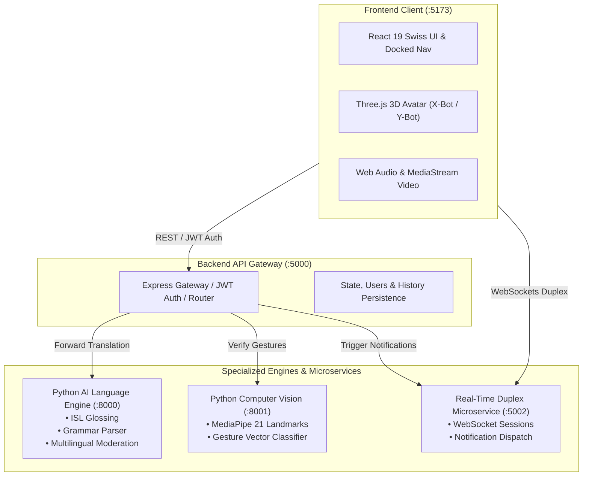

<div align="center">

# Hastivo AI 🤟

### Real-Time Indian Sign Language (ISL) Assistive Communication & 3D Kinematic Avatar Platform

[](https://opensource.org/licenses/MIT)
[](https://nodejs.org/)
[](https://www.python.org/)
[](https://react.dev/)
[](https://threejs.org/)
[](https://fastapi.tiangolo.com/)
[](https://developers.google.com/mediapipe)

**Hastivo AI** bridges communication between the Deaf/Hard-of-Hearing community and hearing individuals across India. It provides low-latency, bidirectional Indian Sign Language (ISL) translation powered by Three.js procedural & FBX 3D avatars, MediaPipe computer vision landmark tracking, and real-time duplex WebSockets.

[Key Features](#key-features) • [Architecture](#architecture-overview) • [Directory Structure](#repository-structure) • [Prerequisites](#prerequisites) • [Installation](#installation--setup) • [Environment Setup](#environment-variable-configuration) • [Testing](#testing--verification) • [Security](#security--governance)

---

</div>

## 1. Problem Statement

Over 18 million Deaf and Hard-of-Hearing citizens in India encounter significant daily barriers in healthcare, government administration, legal services, and education due to a severe shortage of certified Indian Sign Language (ISL) interpreters. Most commercial accessibility tools cater exclusively to American Sign Language (ASL), which differs substantially in grammar, fingerspelling syntax (two-handed in ISL vs. one-handed in ASL), and regional vocabulary.

**Hastivo AI solves this by delivering:**
- An automated Indian Sign Language (ISL) grammar parsing and synthesis engine.
- High-fidelity 3D humanoid avatar kinematic animation (Mixamo X-Bot & Y-Bot rigs + procedural avatars).
- Real-time vision-based sign recognition using 21 3D hand landmarks per hand.
- Full localization in 7 Indian regional languages (**English, Hindi, Tamil, Telugu, Kannada, Malayalam, and Urdu**).
- Zero-placeholder, production-grade architecture that reflects real service statuses without simulated data.

---

## 2. Key Features

- **Bidirectional Translation Engine**:
  - **Text-to-Sign**: Natural language input is parsed into ISL glosses and animated smoothly on a 3D avatar with precise finger, wrist, shoulder, and facial expressions.
  - **Sign-to-Text**: High-frequency webcam frame processing captures two-handed gestures, classifies postures, and produces regional text/speech.
- **Interactive 3D Avatar System**:
  - Mixamo 65-bone humanoid skeletal rig with female (`X-Bot`) and male (`Y-Bot`) models.
  - Procedural hand mesh generation with realistic joint deformation and customizable skin/accent tones.
- **Real-Time Duplex Communication Microservice**:
  - WebSocket-powered room sessions connecting deaf and hearing participants.
  - Simultaneous bidirectional messaging with automated policy moderation.
- **Multilingual Support & RTL Integration**:
  - Full interface support for English, Tamil, Telugu, Kannada, Urdu (with native RTL direction), Malayalam, and Hindi.
- **Cardless Swiss-Style Design System**:
  - Modern, clean, typography-driven visual aesthetic with floating docked navigation, circular remote dial, and command palette (`Ctrl+K` / `Cmd+K`).
- **Comprehensive Administration & Audit**:
  - Role-based access control (Citizen and Administrator roles).
  - Moderation queue, user restriction controls, platform audit logs, and real-time telemetry metrics.

---

## 3. Technology Stack

| Layer | Technologies |
| ----- | ------------ |
| **Frontend** | React 19, Three.js, React Three Fiber, Framer Motion, GSAP, Lenis, Vite, Oxlint |
| **Backend Gateway** | Node.js, Express 4, JSON Web Tokens (JWT), Bcrypt.js, WebSockets |
| **AI Language Service** | Python 3.10+, FastAPI, Pydantic v2, Uvicorn, Pytest |
| **Computer Vision Service** | Python 3.10+, FastAPI, OpenCV, Google MediaPipe Hands, NumPy |
| **Real-Time Microservice** | Node.js, Express, `ws` WebSockets, Brevo Notification Integration |
| **Interactive Showcase** | Vanilla JS, Express, HTML5 Canvas, WebGL |
| **Testing & Verification** | Node.js Test Harness, Pytest, Oxlint Static Analysis |

---

## 4. Architecture Overview



---

## 5. Repository Structure

```
hastivo-ai/
├── .agents/                      # Agent governance and system rule definitions
├── .github/                      # GitHub configuration
│   ├── ISSUE_TEMPLATE/           # Bug report and feature request templates
│   ├── workflows/                # CI/CD GitHub Actions workflow definitions
│   └── PULL_REQUEST_TEMPLATE.md  # Standard pull request checklist
├── ai-service/                   # Python FastAPI Natural Language & Moderation Service
│   ├── app/                      # Application routes, schemas, and language modules
│   ├── tests/                    # Pytest test cases for NLP & moderation
│   ├── requirements.txt          # Python dependencies
│   └── run_server.py             # Service startup runner (:8000)
├── backend/                      # Node.js Express Gateway & Central API
│   ├── server.js                 # API routes, auth, history, and admin logic (:5000)
│   ├── package.json              # Node dependencies
│   └── .env.example              # Gateway environment template
├── computer-vision/              # Python FastAPI MediaPipe Computer Vision Service
│   ├── app/                      # Hand tracking, landmark analysis & gesture classifier
│   ├── tests/                    # Pytest test cases for CV & gesture extraction
│   ├── requirements.txt          # Python dependencies
│   └── run_server.py             # Vision service startup runner (:8001)
├── docs/                         # Additional project architectural documentation
│   ├── ARCHITECTURE.md           # In-depth architectural decomposition
│   ├── DEVELOPMENT.md            # Step-by-step developer onboarding
│   └── API.md                    # REST and WebSocket endpoint specifications
├── documentation/                # Project specifications and OpenAPI definition
│   ├── AI_AND_COMPUTER_VISION_PIPELINE.md
│   ├── DEPLOYMENT_AND_OPERATIONS.md
│   ├── REALTIME_COMMUNICATION_WORKFLOW.md
│   ├── SECURITY_AUTHENTICATION_AND_MODERATION.md
│   ├── SERVICE_RESPONSIBILITIES.md
│   ├── SYSTEM_ARCHITECTURE.md
│   ├── ZERO_PLACEHOLDER_AND_REAL_DATA_POLICY.md
│   └── openapi.yaml              # OpenAPI 3.0 specification
├── frontend/                     # React 19 + Three.js Application
│   ├── public/                   # 3D models (FBX bots), textures, audio, icons
│   ├── src/
│   │   ├── avatar/               # Three.js 3D avatar controllers, kinematics & rigs
│   │   ├── components/           # UI components, cardless design, modals
│   │   ├── contexts/             # Auth, Language, Notification, Theme state providers
│   │   ├── locales/              # 7-language translation dictionaries
│   │   ├── pages/                # Public, Auth, Citizen, Translation, Admin routes
│   │   └── services/             # API client integrations
│   ├── package.json              # Frontend dependencies
│   └── vite.config.js            # Vite build configuration
├── microservice/                 # Express & WebSocket Duplex Real-Time Service (:5002)
│   ├── server.js                 # WebSocket room coordination & notifications
│   └── test_microservice.js      # Microservice unit tests
├── showcase/                     # Standalone Visual Demonstration Engine (:3000)
│   └── server.js                 # Demonstration server
├── testing/                      # Central Verification & Automated Test Suite
│   ├── run_all_tests.js          # Master test orchestrator
│   ├── verify_system.js          # 47-point UI and SRS policy verifier
│   ├── test_backend_suite.js     # Backend gateway & authentication suite
│   └── test_integration_e2e.js   # Multi-service end-to-end integration suite
├── .editorconfig                 # Cross-IDE file formatting rules
├── .gitattributes                # Git line ending normalization
├── .gitignore                    # Comprehensive multi-stack ignore rules
├── CHANGELOG.md                  # Project versioning and history
├── CODE_OF_CONDUCT.md            # Contributor Covenant Code of Conduct
├── CONTRIBUTING.md               # Guidelines for contributing
├── LICENSE                       # MIT License
├── README.md                     # Main repository guide
└── SECURITY.md                   # Security vulnerability disclosure policy
```

---

## 6. Prerequisites

Ensure your environment has the following tools installed:
- **Node.js**: `v18.x`, `v20.x`, or `v24.x`
- **npm**: `v9.x` or higher
- **Python**: `3.10` through `3.14`
- **Git**
- Web browser with **WebGL 2.0** and **MediaStream Camera/Microphone** support

---

## 7. Installation & Setup

### Step 1: Clone the Repository
```bash
git clone https://github.com/your-username/hastivo-ai.git
cd hastivo-ai
```

### Step 2: Install Node.js Dependencies
```bash
# Frontend
cd frontend && npm install && cd ..

# Backend Gateway
cd backend && npm install && cd ..

# Real-Time Microservice
cd microservice && npm install && cd ..

# Central Testing Suite
cd testing && npm install && cd ..
```

### Step 3: Install Python Dependencies
```bash
# Create and activate virtual environment
python -m venv venv

# Windows
.\venv\Scripts\Activate.ps1
# Linux / macOS
source venv/bin/activate

# Install AI Service dependencies
pip install -r ai-service/requirements.txt

# Install Computer Vision dependencies
pip install -r computer-vision/requirements.txt
```

---

## 8. Environment Variable Configuration

Copy the sample environment configurations for each service:

```bash
cp frontend/.env.example frontend/.env
cp backend/.env.example backend/.env
cp ai-service/.env.example ai-service/.env
cp computer-vision/.env.example computer-vision/.env
cp microservice/.env.example microservice/.env
```

### Environment Parameters Overview

| File | Key Variables | Description |
| ---- | ------------- | ----------- |
| `frontend/.env` | `VITE_API_BASE_URL`<br/>`VITE_WS_URL` | Backend Gateway HTTP endpoint (`http://localhost:5000`) and WebSocket endpoint (`ws://localhost:5000`) |
| `backend/.env` | `PORT`<br/>`JWT_SECRET`<br/>`AI_SERVICE_URL`<br/>`CV_SERVICE_URL`<br/>`MICROSERVICE_URL` | Port (`5000`), secure signing secret, and inter-service routing URLs |
| `ai-service/.env` | `PORT`<br/>`HOST`<br/>`MODEL_NAME` | Service Port (`8000`), bind address (`0.0.0.0`), and translation model ID |
| `computer-vision/.env` | `PORT`<br/>`MIN_DETECTION_CONFIDENCE`<br/>`MAX_NUM_HANDS` | Vision Port (`8001`), MediaPipe threshold (`0.65`), and maximum hands (`2`) |
| `microservice/.env` | `PORT`<br/>`AI_SERVICE_URL`<br/>`CV_SERVICE_URL` | WebSocket Microservice Port (`5002`) and upstream service URLs |

> [!CAUTION]
> Never commit actual credentials, private certificates, or production `.env` files into source control. All `.env` files are excluded by `.gitignore`.

---

## 9. Development Execution Commands

Run each service in separate terminal windows:

```bash
# 1. Backend Gateway (Port 5000)
cd backend && npm run dev

# 2. AI Language Engine (Port 8000)
cd ai-service && python run_server.py

# 3. Computer Vision Engine (Port 8001)
cd computer-vision && python run_server.py

# 4. Real-Time Microservice (Port 5002)
cd microservice && npm start

# 5. Frontend Application (Port 5173)
cd frontend && npm run dev
```

Open **`http://localhost:5173`** in your browser.

---

## 10. Production Build Instructions

To build the client application for production:
```bash
cd frontend
npm run build
```
Production assets are generated in `frontend/dist/`. To preview the production bundle locally:
```bash
npm run preview
```

---

## 11. Testing & Verification

Hastivo includes a comprehensive test framework verifying UI policies, SRS compliance, backend routing, AI translations, computer vision, and duplex messaging.

Run all test suites with the master test orchestrator:
```bash
cd testing
node run_all_tests.js
```

### Master Test Suite Breakdown:
1. **System Verification & UI Policy (`verify_system.js`)**: Verifies 7 multilingual dictionaries, route registry completeness, and cardless navigation compliance.
2. **Core Backend Gateway & Auth Suite (`test_backend_suite.js`)**: Tests registration, login, JWT validation, conversation history, and administration endpoints.
3. **Python AI Language Engine (`pytest ai-service`)**: Tests text-to-sign grammar synthesis, language detection, and content moderation.
4. **Python Computer Vision Engine (`pytest computer-vision`)**: Tests 21-point 3D hand tracking and gesture classification.
5. **Real-Time WebSocket Microservice (`test_microservice.js`)**: Tests duplex WebSocket messaging and notification dispatching.
6. **Multi-Service E2E Integration Suite (`test_integration_e2e.js`)**: Tests end-to-end communication across running services.
7. **Frontend Production Build**: Validates compilation, bundle size, and tree-shaking via Vite.

---

## 12. Screenshots & Interface Showcase

<!-- Placeholder for product screenshots & animated demonstration -->
| 3D Avatar Translation | Real-Time Duplex Room |
| :---: | :---: |
| *[Screenshot: Interactive 3D Avatar Rendering ISL]* | *[Screenshot: Real-Time Accessible Conversation]* |

| Multilingual Vocabulary Explorer | Admin Telemetry & Moderation |
| :---: | :---: |
| *[Screenshot: Indian Sign Language Explorer]* | *[Screenshot: Administrative Telemetry & Monitoring]* |

---

## 13. Security & Governance

- **Zero-Placeholder Policy**: Production screens never display hardcoded, fake, or mock statistics. When external services or models are unconfigured, explicit `UnavailableState` components are rendered with clear user guidance.
- **Role-Based Access Control (RBAC)**: All protected routes and API operations enforce JWT-based authorization for Citizen and Administrator tiers.
- **Automated Content Moderation**: Outbound messages and recognized signs pass through real-time multilingual moderation filters.
- **Reporting Vulnerabilities**: See [SECURITY.md](SECURITY.md) for details on our responsible disclosure process.

---

## 14. Contributing & License

We welcome contributions from developers, accessibility researchers, and sign language experts. Please read our [CONTRIBUTING.md](CONTRIBUTING.md) and [CODE_OF_CONDUCT.md](CODE_OF_CONDUCT.md) before submitting pull requests.

Distributed under the **MIT License**. See [`LICENSE`](LICENSE) for details.

