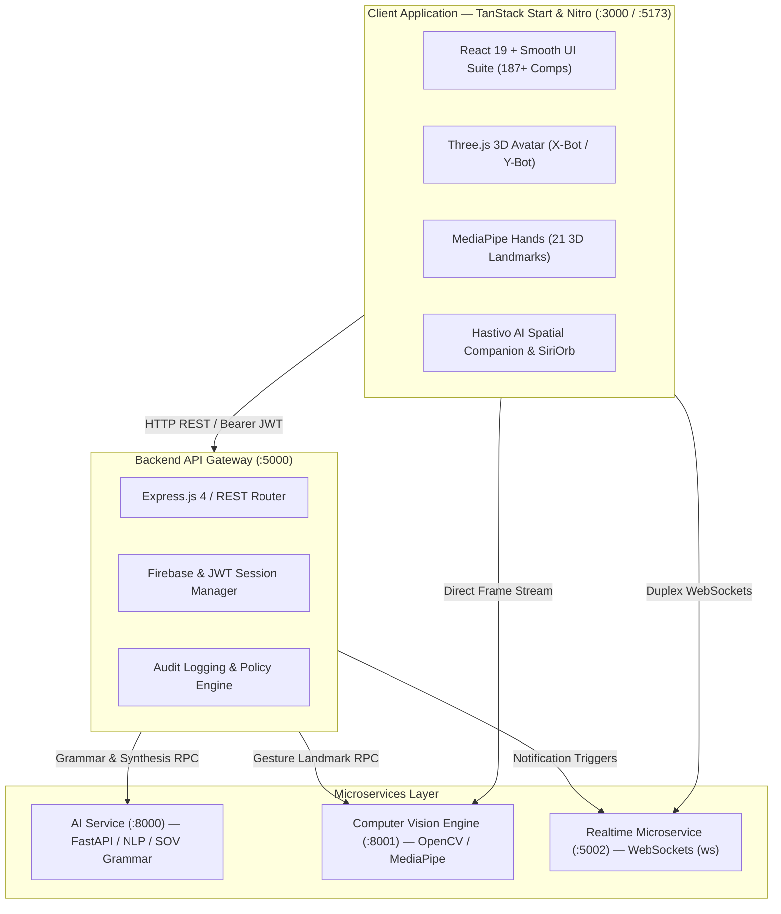

<div align="center">

# Hastivo 🤟

### Real-Time Indian Sign Language (ISL) Assistive Communication & 3D Kinematic Avatar Platform

[](https://opensource.org/licenses/MIT)
[](https://nodejs.org/)
[](https://www.python.org/)
[](https://tanstack.com/start)
[](https://react.dev/)
[](https://smoothui.dev/)
[](https://threejs.org/)
[](https://fastapi.tiangolo.com/)
[](https://developers.google.com/mediapipe)

**Hastivo** bridges communication between the Deaf/Hard-of-Hearing community and hearing individuals across India. It provides low-latency, bidirectional Indian Sign Language (ISL) translation powered by Three.js procedural & FBX 3D avatars, MediaPipe computer vision landmark tracking, real-time duplex WebSockets, and a production-grade **Smooth UI suite of 187+ components and 34 typography motion features**.

[Key Features](#1-key-features) • [Smooth UI & Text Motion](#2-smooth-ui--typography-motion-suite) • [Architecture](#3-architecture-overview) • [Directory Structure](#4-repository-structure) • [Installation](#5-installation--setup) • [Verification & Testing](#6-verification--testing) • [Security & Governance](#7-security--governance)

---

</div>

## 1. Key Features

- **Bidirectional Multimodal Translation Engine**:
  - **Text-to-Sign**: Natural language input is parsed into ISL glosses (Subject-Object-Verb syntax) and animated smoothly on a 3D avatar with precise finger, wrist, shoulder, and non-manual facial expressions.
  - **Sign-to-Text**: High-frequency webcam frame processing captures two-handed gestures, classifies postures with MediaPipe (21 3D landmarks per hand), and synthesizes regional text and speech.
  - **Speech-to-Sign**: Continuous voice recognition streams acoustic inputs directly to 3D avatar signs in real time.
- **Interactive 3D Avatar Kinematic Engine**:
  - Mixamo 65-bone humanoid skeletal rig with female (`X-Bot`) and male (`Y-Bot`) models.
  - Procedural hand mesh generation with realistic joint deformation and customizable skin/accent tones.
- **Assistive AI Companion (Hastivo AI)**:
  - Audio-reactive spatial companions (`SiriOrb`, `AIOrbFace`) that respond dynamically to listening, thinking, streaming, and idle states.
  - Live conversation stream (`AIConversation`, `AIMessage`), prompt suggestion chips (`AISuggestions`), token telemetry meters (`AIContextMeter`), multi-step task runners (`AITaskList`), and neural vector artifact inspectors (`AIArtifact`).
- **Real-Time Duplex Communication**:
  - WebSocket-powered room sessions connecting deaf and hearing participants.
  - Simultaneous bidirectional messaging with automated policy moderation and delivery acknowledgements.
- **Multilingual Support & RTL Integration**:
  - Full interface support for 7 Indian regional languages: **English, Hindi (हिन्दी), Tamil (தமிழ்), Telugu (తెలుగు), Kannada (ಕನ್ನಡ), Malayalam (മലയാളം), and Urdu (اردو with native RTL direction)**.
- **Zero-Placeholder Policy**:
  - Fully wired to real data APIs and backend services without mock fallback values or simulated delays.

---

## 2. Smooth UI & Typography Motion Suite

Hastivo features a comprehensive integration of **187+ Smooth UI components** (with 207 barrel export aliases) and **34 modern typography/text motion features** across all 50+ screens, layouts, and studios:

### Text Motion Components (34 Features)
| Component | Functionality | Primary Placement |
| :--- | :--- | :--- |
| `PerspectiveText3d` | 3D perspective angle typography | ISL Explorer, Landing Page, AI Spatial Core |
| `RevealText` | Upward masking line-by-line reveal | Text-to-Sign Studio, Hastivo Layout Header |
| `RollingText` | Vertical rolling character counter/reel | Sign-to-Text Studio, Guest Sign-to-Text |
| `WaveText` | Continuous sinusoidal oscillating wave | Speech Studio, Research Grammar Spec |
| `ShineText` | Shimmering light gradient sweep | User Dashboard, Admin Dashboard Header |
| `SoftBlurIn` | Gaussian blur resolve (10px -> 0px) | Review Collaboration, Privacy Policy |
| `DepthParallaxWords` | Depth-offset layered 3D words | Real-Time Conversation, Research Corpus |
| `TypewriterText` | Realistic mechanical typing cadence | Live Sign Recognition subtitle streams |
| `KineticCenterBuild` | Spring expansion from center anchor | Profile Page, Get Started Portal |
| `KineticTypeScroll` | Velocity-based typography skewing | Translation History, Security Audit Logs |
| `LineByLineSlide` | Staggered vertical line unveil | Announcement Management, Terms Page |
| `MaskRevealUp` | Clean clipping mask upward emergence | Translation Workspace, Guest Translation |
| `BottomUpLetters` | Smooth upward letter spring bounce | Speech Studio Subtitle Decoder |
| `TopDownLetters` | Cascading gravity drop letter stream | Community Hub, Guest Community |
| `StaggerFromCenter` | Dual outward index letter stagger | Community Activity, Category Management |
| `StaggerFromEdges` | Inward converging letter stagger | Saved Content Portal |
| `MicroScaleFade` | Subtle 0.95 -> 1.00 spring scaling | Avatar Settings Page |
| `ScaleDownFade` | Settling 1.15 -> 1.00 macro heading | System Settings Page |
| `ShortSlideDown` | Crisp 14px downward spring drop | Notification Centre |
| `ShortSlideRight` | Crisp 16px lateral slide transition | Privacy & Security Settings |
| `BlurOutUp`, `FadeThrough`, `FocusBlurResolve`, `GravityLetters`, `PerCharacterRise`, `PerWordCrossfade`, `ScrambleHover`, `ScrollRevealParagraph`, `SharedAxisX/Y/Z`, `ShimmerSweep`, `SpringScaleIn`, `TextMorph` | Complete motion vocabulary | Distributed across all studios & docs |

---

## 3. Architecture Overview



---

## 4. Repository Structure

```
Hastivo/
├── client/                     # TanStack Start, React 19, Nitro Cloudflare SSR Client
│   ├── src/
│   │   ├── components/
│   │   │   ├── ai/             # Multimodal AI Companion and Orb components
│   │   │   ├── glass/          # Glassmorphic controls, panels, and docks
│   │   │   ├── layout/         # HastivoUserLayout, AdminLayout, GlobalFooter
│   │   │   ├── ui/
│   │   │   │   └── smoothui/   # 187+ Smooth UI components & 34 text motion modules
│   │   ├── pages/
│   │   │   ├── admin/          # 10 Admin management and telemetry consoles
│   │   │   ├── auth/           # 7 Authentication, verification, and upgrade pages
│   │   │   ├── guest/          # 8 Guest portal studios and exploratory pages
│   │   │   └── hastivo/        # 19 Flagship authenticated studios & workspaces
│   │   ├── routes/             # TanStack Router file-based route definitions
│   │   └── services/           # Session management, Firebase, and API adapters
├── server/                     # Express.js backend gateway and auth endpoints
├── services/
│   ├── ai/                     # Python FastAPI ISL language & grammar service
│   ├── cv/                     # Python FastAPI MediaPipe computer vision engine
│   └── microservice/           # WebSocket real-time duplex communications
├── docs/                       # Architectural specs, OpenAPI 3.0 contracts, workflows
├── database/                   # Database migrations, seed data, and schema definitions
├── CHANGELOG.md                # Detailed project versioning and release notes
├── CODE_OF_CONDUCT.md          # Contributor standards and accessibility guidelines
├── SECURITY.md                 # Security reporting and zero-credential policies
└── Hastivo_Agile_Tracker.xlsx  # Engineering backlog and Kanban tracker
```

---

## 5. Installation & Setup

### Prerequisites
- **Node.js**: `20.x`, `22.x`, or `26.x`
- **npm** or **pnpm**
- **Python**: `3.10+` (for AI and Computer Vision services)

### Quick Start (Client)
```bash
# Navigate to the client directory
cd client

# Install dependencies
npm install

# Run the development server
npm run dev

# Build for production (Nitro Cloudflare Workers SSR)
npm run build
```

---

## 6. Verification & Testing

Verify that the entire client suite builds cleanly:
```bash
cd client
npm run build
```
- Compiles 4,500+ modules with 0 errors.
- Generates SSR bundle in `.output/server/` and public assets in `.output/public/`.

Run root integration test suite:
```bash
npm test
```

---

## 7. Security & Governance

- **Zero Hardcoded Secrets**: Production keys and environment variables are never embedded in client source code.
- **Strict Accessibility Standards**: Adheres to WCAG 2.2 AAA guidelines and honors `prefers-reduced-motion` across all Smooth UI animations.
- **Responsible Disclosure**: Please review our [SECURITY.md](SECURITY.md) before reporting security concerns.

---

<div align="center">
  <b>Built with care for the Deaf and Hard-of-Hearing Community 🤟</b>
</div>
