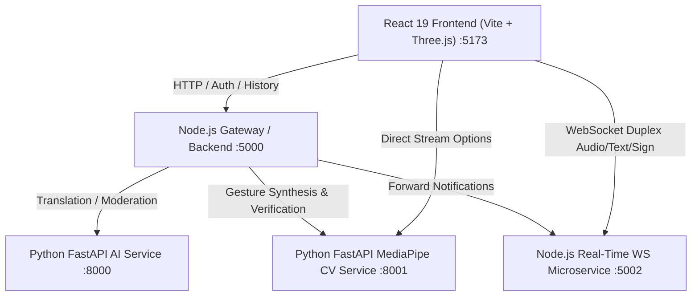

# Hastivo — System Architecture

This document describes the high-level architecture, module decomposition, and data flow of **Hastivo**.

## Service Overview

| Service | Technology | Port | Primary Responsibilities |
| ------- | ---------- | ---- | ------------------------ |
| **Frontend** | React 19, Three.js, Vite | 5173 | 3D Avatar Rendering, Sign/Text UI, 7-Language Localization, Audio I/O |
| **Backend Gateway** | Node.js, Express, JWT | 5000 | Auth, Route Guarding, Audit Logging, Inter-Service Orchestration |
| **AI Service** | Python, FastAPI, Pydantic | 8000 | ISL Translation Syntax, LLM Processing, Multi-lingual Moderation |
| **Vision Service** | Python, FastAPI, MediaPipe | 8001 | 21 3D Hand Landmark Tracking, Dynamic Gesture Classification |
| **Microservice** | Node.js, Express, WebSockets | 5002 | Duplex Messaging, Session Signaling, Brevo Notification Dispatch |
| **Showcase** | Vanilla JS / Express | 3000 | Standalone Telemetry & Interactive Feature Showcase |

## Key Technical Workflows

### 1. Text-to-Sign Pipeline
1. User enters text or speaks via Web Speech API in any supported regional language.
2. Gateway routes text to AI Language Service (`:8000/api/translate/text-to-sign`).
3. Text is parsed into Indian Sign Language (ISL) glosses and kinematic gesture tokens.
4. Three.js Avatar Engine decodes tokens into bone rotations, skeletal transforms, and facial blend shapes.

### 2. Sign-to-Text Pipeline
1. Webcam stream captures hand movements frame-by-frame.
2. MediaPipe Hands extracts 21 3D landmarks per hand.
3. Feature vectors feed into the gesture classifier (`:8001/api/vision/recognize-frame`).
4. Matched sign tokens are mapped to regional natural language sentences.

### 3. Real-Time Duplex Communication
1. WebSockets on `:5002` handle message exchange between deaf/hard-of-hearing citizens and hearing participants.
2. Messages are dynamically checked against the moderation pipeline.
3. If an external service dependency is unreachable, structured unavailable states are signaled with zero fake or placeholder data.

