# Signora AI — Real-Time Duplex Communication Protocol

## 1. Overview

The Real-Time Conversation module provides simultaneous, non-blocking two-way communication between:
- **Participant A (Hearing Speaker)**: Speaks into microphone &rarr; audio transcribed &rarr; animated by 3D Avatar for Participant B.
- **Participant B (Deaf Signer)**: Signs into camera &rarr; computer vision recognizes gestures &rarr; synthesized into natural speech audio for Participant A.

```mermaid
sequenceDiagram
    autonumber
    actor A as Participant A (Speaker)
    participant WS as Microservice (:5002)
    actor B as Participant B (Signer)

    A->>WS: conversation:join { roomId, role: 'speaker' }
    B->>WS: conversation:join { roomId, role: 'signer' }
    WS-->>A: conversation:joined
    WS-->>B: conversation:joined

    rect rgb(30, 40, 50)
    Note over A, WS: Pipeline A: Speech to Avatar Sign
    A->>WS: speech:transcript { text: "Where is the train?" }
    WS-->>B: avatar:sequence { text, poses, timings }
    end

    rect rgb(40, 30, 40)
    Note over B, WS: Pipeline B: Sign to Voice Speech
    B->>WS: sign:detected { gloss: "PLATFORM_THREE", conf: 0.98 }
    WS-->>A: caption:updated { text: "Platform three" }
    WS-->>A: audio:generated { playTTS: true }
    end
```



---

## 2. Event Catalog & Payload Specifications

### 1. `conversation:join`
```json
{
  "event": "conversation:join",
  "roomId": "duplex_session_01",
  "data": {
    "userId": "usr_citizen_002",
    "role": "speaker"
  }
}
```

### 2. `speech:transcript`
```json
{
  "event": "speech:transcript",
  "roomId": "duplex_session_01",
  "data": {
    "text": "Hello, how can I assist you today?",
    "speaker": "usr_citizen_002",
    "timestamp": "2026-11-02T14:30:00.000Z"
  }
}
```

### 3. `sign:detected`
```json
{
  "event": "sign:detected",
  "roomId": "duplex_session_01",
  "data": {
    "gloss": "HELP",
    "confidence": 0.96,
    "signer": "usr_citizen_004",
    "timestamp": "2026-11-02T14:30:02.000Z"
  }
}
```

### 4. `conversation:pause` / `conversation:resume` / `conversation:end`
Controls session status across all connected participants.
