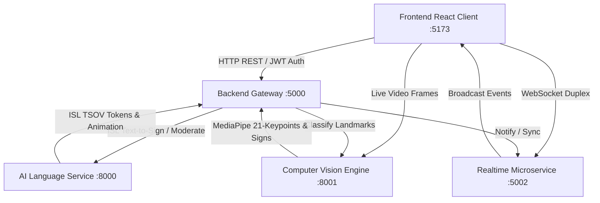

# Hastivo AI — System Architecture & Topology

## 1. System Overview

Hastivo is an assistive communication platform bridging the communication gap between Deaf/Hard-of-Hearing individuals and hearing individuals using Indian Sign Language (ISL). 

The platform is engineered as an interconnected, microservice-oriented ecosystem partitioned into eight specialized directories, each with distinct lifecycle responsibilities.

---

## 2. Directory & Service Topology

| Directory | Primary Technology | Default Port | Role & Responsibility |
|---|---|---|---|
| `frontend/` | React 19, Three.js, Vite | `5173` | Cardless client workspace, 3D humanoid avatar, 7 localized languages, floating nav, command palette. |
| `backend/` | Node.js, Express, JWT, bcrypt | `5000` | Core API Gateway, authentication, role-based access control, profile/preferences persistence, translation bridge, audit logging. |
| `ai-service/` | Python 3.14, FastAPI, Pydantic | `8000` | Natural language processing, ISL Subject-Object-Verb (SOV) grammatical reordering, sign synthesis, contextual sentence generation, and AI safety moderation. |
| `computer-vision/` | Python 3.14, OpenCV, MediaPipe | `8001` | 21-joint 3D hand tracking, finger extension analysis, palm orientation, ISL gesture classification, and landmark visualization. |
| `microservice/` | Node.js, Express, WebSocket (`ws`) | `5002` | Independent real-time duplex communication hub (`/ws/v1/conversation`) and user notification broker (Brevo / email dispatch). |
| `showcase/` | HTML5, Vanilla CSS, Express | `4000` | Interactive multi-service demonstration environment, live health matrix, and pipeline debuggers. |
| `testing/` | Node.js, Python Pytest | N/A | Unified testing suite running 7 automated test suites across all tiers. |
| `documentation/` | Markdown, OpenAPI 3.0 | N/A | Architectural specifications, API contracts, workflows, security, and deployment guides. |

---

## 3. Communication Protocols

1. **Client &harr; Backend Gateway**: RESTful HTTP/JSON with standard `Authorization: Bearer <JWT>` headers.
2. **Backend Gateway &harr; AI Service**: Internal HTTP microservice RPC (`http://localhost:8000/api/v1/ai/*`).
3. **Backend Gateway &harr; Computer Vision**: Internal HTTP RPC (`http://localhost:8001/api/v1/vision/*`).
4. **Client &harr; Microservice**: Low-latency WebSocket duplex connection (`ws://localhost:5002/ws/v1/conversation`).
5. **Backend Gateway &harr; Microservice**: Event notification trigger over HTTP REST (`http://localhost:5002/api/v1/notifications/send`).
